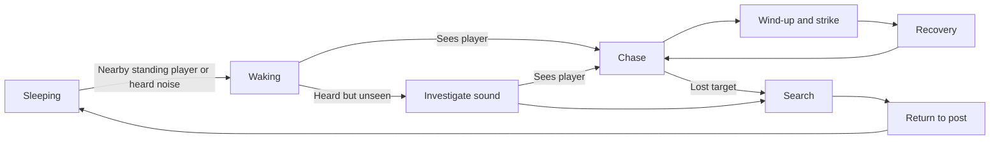

# Enemy stealth and attack framework

Open `scenes/levels/stealth_sandbox.tscn` and press **F6** in Godot 4.7.2 Standard. Two enemies start asleep. Crouch past them without using ammunition, or disturb them and try escaping or dodging their swings. The low passage gives the smaller player capsule an escape route. Your town layout and existing enemy artwork are preserved.

## Behaviour

The old AI switched between patrol and chase based only on distance and damaged the player on contact. The new AI has sleeping, waking, idle, patrol, investigate, chase, attack, recovery, search, return, hit, and death states.

A sleeper ignores the crouched player's proximity by default, allowing the player to pass completely across its position. Standing still or walking within **Wake Proximity Radius** (140) and a clear line disturbs it. The enemy then spends **Wake Seconds** (0.5) waking up before pursuing. There is no damage merely from touching its body.

Awake enemies have directional vision with solid-geometry checks. Default **Detection Radius** is 330 and **View Angle Degrees** is 140. Crouching halves that visual range; it does not make the player invisible. Within **Awake Close Radius** (42), an awake enemy can notice the player from either side. Sneaking directly through an awake guard is unsafe; choose a sleeping route, use cover/distance, lure it elsewhere, or time a dodge.

An unseen sound sends the enemy to the sound's last position, rather than continuously revealing the player through walls. Losing sight leaves **Memory Seconds** (1.6) of pursuit, followed by a **Search Seconds** (3.0) search and a return to its original post. A sleeper can go back to sleep; a guard returns to idle and a patroller resumes patrol. **Pursuit Distance** (650 from its post) limits its territory and perception; use 0 for no territory limit.

Patrols pause and turn at their bounds. Ground probes prevent walking off platforms. Living enemies leave each other **Personal Space** (34), and nearby enemies avoid starting simultaneous strikes within **Nearby Attack Spacing** (110). They may attack in succession, so waking a group remains dangerous.

## Place different enemies

Drag a scene into the level's Actors node:

| Scene | Initial behaviour |
| --- | --- |
| `scenes/actors/enemy.tscn` | Sleeping |
| `scenes/actors/enemy_guard.tscn` | Stationary, awake guard |
| `scenes/actors/enemy_patrol.tscn` | Awake patrol |

All use the same script, frame dimensions, and animation resources. On any enemy root, change **Initial Behaviour** and **Facing Direction** in the Inspector. Keep instances separated rather than placing them directly on top of each other. Place sleeping enemies on flat ground, not inside low ceilings that their standing capsule cannot fit beneath.

For a forgiving route, place sleepers with a generous Wake Proximity Radius, allowing room to crouch before reaching them. For a dangerous route, add awake patrols, position them to watch access points, and provide a designer-authored alternate route or cover. Remember that background house/prop sprites do not block vision by themselves: physical geometry on collision layer 1 does.

## Hearing and player actions

Noise is a gameplay event, independent of audio volume and whether a sound file is playing. The following Inspector settings live on **Player → Stealth Noise**:

| Action | Default hearing radius |
| --- | --- |
| Crouch footsteps | 0 — silent |
| Walking footsteps | 135 |
| Sprinting footsteps | 255 |
| Jump takeoff | 160 |
| Hard landing | 200 |
| Dodge | 180 |
| Reload starts | 70 |
| Gun fires a real round | 850 |

Footstep events follow actual movement on the ground. Moving against an immovable wall does not produce moving footsteps. Crouching does **not** silence gunfire, reloads, or landings. An empty magazine does not emit a gunshot event. A gunshot can wake several nearby enemies even if its ray misses; this is one reason to conserve ammunition and bypass a group.

Each enemy has **Hearing Multiplier** (1.0). Solid geometry reduces heard radii by **Obstructed Hearing Multiplier** (0.4). A sufficiently loud sound can still travel through a wall, but that does not grant vision. Different enemies can therefore have different hearing without changing the player.

The flashlight does not currently change awareness. Other environmental sound effects, such as a bell, are not automatically hearing events. Future gameplay code can use `Game.emit_noise(world_position, radius, source_node)` for a thrown object, alarm, or other disturbance; the sound's position becomes the investigation point. This hook does not require changing the save format or each enemy script.

## Add the attack animation

1. Open an enemy scene and select **Body**.
2. Click **Sprite Frames**, then select the named **attack** animation. Replace its placeholder frames with your own 40 × 72 game frames, keeping the feet at the bottom of the canvas. Turn **Loop** off.
3. Select the enemy root and adjust the attack timing fields below to match when the animation makes contact.
4. Once your art contains the swing/lunge, turn **Use Attack Placeholder Pose** off. The current placeholder shifts the existing character sprite during wind-up and impact; there is no arc graphic.
5. Enable **Editable Children** on an instance and expand **AttackPivot → Hitbox → CollisionShape2D** to edit the actual damage box in the 2D editor. Its positive-X side is the right-facing strike. The script mirrors the pivot for left-facing attacks. Make the shape resource unique if one instance needs different geometry.

| Root setting | Default | Effect |
| --- | --- | --- |
| Attack Trigger Range | 62 | Distance at which the enemy may commit to a swing |
| Attack Windup Seconds | 0.32 | Visible warning with no damage |
| Attack Active Seconds | 0.10 | Brief window in which the authored hitbox can hit |
| Attack Recovery Seconds | 0.58 | Vulnerable pause after the strike, with no damage |
| Attack Interval | 1.1 | Minimum time between attack starts |

The **attack** clip is fitted to the sum of wind-up, active time, and recovery. Adjust the clip's relative frame durations and the root timing fields so its contact pose falls in the active window. Attack Interval cannot shorten the full animation cycle. The extra cooldown, if any, holds the recovery pose.

Facing is committed when the swing begins. The enemy does not turn or slide after the player mid-swing. Damage requires the player to overlap the hitbox and have a clear solid-geometry ray at impact. A swing attempts contact only once, including when the player's dodge invulnerability blocks it. Leaving the range, moving behind the enemy, or timing the short dodge can avoid it. Touching a sleeping, idle, chasing, winding-up, or recovering enemy does no automatic damage.

## Hit reactions and resisting stun-lock

Real damage always reduces health. A fresh stagger cancels a pending attack and plays **hit** for **Hit Reaction Seconds** (0.18). **Stagger Cooldown Seconds** (0.85) prevents every successive bullet from resetting the enemy's attack. During that cooldown, an ongoing attack continues with hit-color feedback; outside an attack a hit pose can play without stopping movement. Set the cooldown to 0 if a particular enemy should be interrupted by every hit.

Death cancels all pending attack damage immediately. Existing death timing, optional corpses, defeated-state saving, and missing-animation fallbacks remain functional. See [CHARACTER_GUIDE.md](CHARACTER_GUIDE.md) for inserting hit/death art.

## Sleep and wake animation slots

The Body's SpriteFrames also contains **sleep** (looping) and **wake** (non-looping). Replace these like any other clip. **Wake Seconds** controls the fitted wake duration. The current sleep/wake poses use the existing sprite with temporary compression; disable **Use Sleep Placeholder Pose** when replacing them with actual posed art.

For debugging, inspect an enemy's remote `state`, `last_known_position`, and timers while the game runs, or connect its `state_changed` signal. No state labels, control legends, or alert meters are added to the game HUD.

## Saves and limits

Defeated enemies remain recorded in each independent bicycle save. Alertness, a current swing, partial enemy health, investigation position, and corpses are transient: loading/re-entering reconstructs living enemies in their authored initial behaviour. A save made before a defeat restores the enemy alive; one made after restores its absence.

This is a ground-based AI framework. It handles sight, hearing, state changes, spacing, walls, and ledges, but does not jump, climb, open doors, find alternate platform routes, or follow the player through location transitions. Design reachable patrol ground and intentional bypasses. No new story content or character art has been introduced.

Run `GODOT_BIN=/path/to/godot bash tools/check.sh aiming narrative combat stealth` for current feature checks with isolated test saves. The stealth suite verifies real crouch/sprint movement, perception through geometry, searching, patrols, ledges, timed strikes, evasion, interruption, and missing attack clips.
