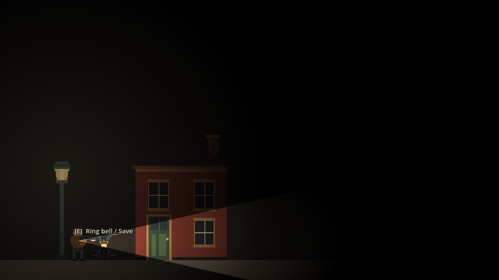
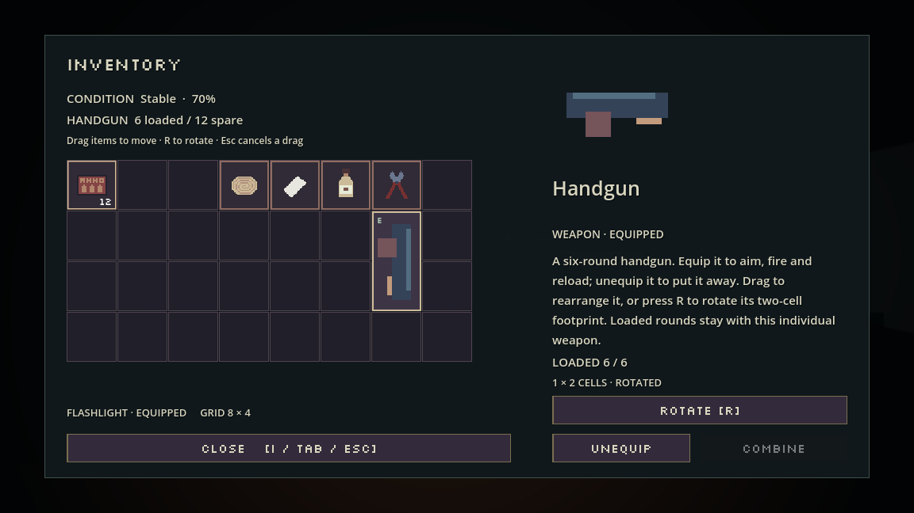
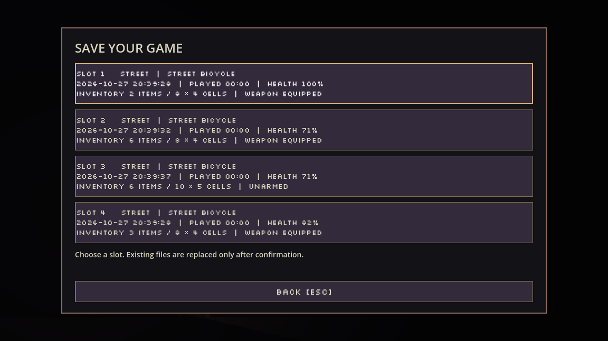

# Ignotum / development foundation 06

A desktop Godot 4 side-view survival-horror foundation with original pixel art. No authored story, forced quest, campaign ending, or victory screen. Start on a street, enter a building or alley with E, and return through matching entrances. These small connected spaces demonstrate the reusable location system; they are not a campaign.

## Open and play

Use **Godot 4.4+ Standard edition** (validated on 4.4.1 and 4.6.3). Import `project.godot` and press **F5**. No plugins or .NET installation required.

| Control | Action |
| --- | --- |
| A/D or arrows | Move |
| Space / W | Jump (buffered, with coyote time) |
| Right mouse / left click | Held aim / fire |
| R / Q / Alt | Reload / melee / dodge |
| E | Collect, examine, operate, or enter |
| F | Flashlight (also works while unarmed) |
| Drag / R in inventory | Move / rotate items |
| I or Tab / Esc | Toggle grid inventory / pause |

**Main menu:** New game, Load game (four slots), Options (volume/fullscreen), Quit. Saving is manual: approach a bicycle, press E to ring its bell, and choose a slot. Occupied slots require overwrite confirmation. There is no saving from the pause menu or when changing rooms. Loading restores your saved world/inventory and returns beside the bicycle. Starting a new game leaves all four files intact. Partial enemy health and active animations are not saved.

## Grid inventory and equipment

The starting bag is **8×4 cells**, with drag placement and 90° rotation. The handgun is a **2-cell item**: select it to **Equip/Unequip**. Every weapon instance keeps its own magazine; future weapon resources supply their own size, ammunition and firearm stats. Keys, puzzle objects and weapons can use larger rectangles through exported Inspector fields. Starting capacity is editable in `data/inventory_settings.tres`, with an expansion hook for future upgrades. Invalid moves, full-grid pickups and failed recipes preserve all items.

Each save slot stores a separate complete snapshot: inventory layout and quantities, per-weapon rounds, equipped weapon, capacity, health, puzzle flags, pickups, gates and defeated enemies. Loading replaces current state atomically. Version-2 bicycle saves remain readable and are migrated in memory; their files are preserved until explicitly overwritten at a bicycle.

## Simplified sprite replacement

The redesign is implemented as **29 individual production sprite PNGs**: 28 scenery/prop/item/enemy replacements at their existing paths, plus a new cream-house variant. Player and ammo PNGs are preserved. Buildings have smaller native dimensions and simpler surfaces; scene positions, door selection shapes, and light offsets have been adjusted accordingly.

`art/pixel/STYLE_SHEET.png` shows the actual assets now used by the project. See [ART_STYLE_GUIDE.md](ART_STYLE_GUIDE.md) for native sizes and the exact 2× pixel workflow. The earlier illustrated sheet is only an art reference.

## Exploration and inventory

Exploration has no fixed HUD panels, logo, controls strip, or permanent crosshair. Health briefly appears after damage (and remains subtly visible when critical). Ammo/crosshair appear only during aiming, recent firing, or reload. Hold right mouse to aim and move carefully. Controls are available from Pause → Controls.

Pickups are just their artwork. A nearby **[E] Take** prompt identifies an action, not the item. Collecting does not announce its name. Open I or Tab, drag items to arrange them, press R to rotate, and select an icon with the mouse or keyboard, and read its name, description, category, quantity, and artwork. Medical supplies can be **Used**; select **Combine** on a material, then select its partner. Cloth + antiseptic creates a field dressing that heals 30. Matching stacks can also be combined: 20 + 2 rounds becomes 22; 20 + 10 becomes 24 + 6. Full-health use and failed combinations waste nothing.

The building contains bolt cutters. Carry them to the alley's chained gate to permanently open access to a medical supply. All additions are authored scene instances with editable item resources and recipe resources, not a mandatory quest. No story or ending is attached.

Sources and the specific design adaptations are documented in [INSPIRATION_NOTES.md](INSPIRATION_NOTES.md).

## Design your own game

- **[DESIGNER_GUIDE.md](DESIGNER_GUIDE.md):** edit locations and link door/alley destinations without programming.
- **[ART_STYLE_GUIDE.md](ART_STYLE_GUIDE.md):** dimensions, palette, pixel rules, replacement workflow.
- **`art/pixel/STYLE_SHEET.png`:** labeled visual asset sheet.
- **`art/pixel/source/`:** native-resolution PNGs to edit in your pixel editor.
- **`art/pixel/ignotum.gpl`:** original kit palette; your revised asset colors and bicycle palette are described in the art guide.

All environments, characters, props, entrances, and colliders are authored editor-visible nodes. The older source images have ready-to-use 2× PNGs, and character sheets include six walk frames. The new bicycle is one native 32×28 PNG, scaled 2× by its scene. Smooth lighting gradients are intentionally separate from pixel art.

## Previews

Exploration:



Inventory inspection:



Bicycle save menu:



## Validation

```sh
bash tools/check.sh
```

This imports resources and runs five integration suites in isolated user-data folders. Gameplay checks cover movement, combat, exact 0.5-second dodge, puzzles, persistent world state, and transitions. Interface checks cover quiet HUD, inspection, healing and recipes. Asset checks cover imported textures. Manual-save checks repeatedly switch between files containing different actual pickups, puzzle completion, gates, enemy state, health, layout, capacity and equipment. Grid checks use real mouse/key events for drag, rotation, canceled/invalid drops, stack merging and equipment; they also cover fragmentation, independent weapon magazines, snapshot validation and upgrade hooks. All suites must finish with zero failures; script/resource errors are failures even if Godot returns zero.

With a graphical display, `godot --path . res://tests/capture.tscn` writes screenshots to `/tmp/ignotum-*.png`. The example layouts now include your revisions from `human-changes`. Physical audio output, standalone exports, and other operating systems have not been tested. The Silkscreen UI font is distributed under its included OFL license in `art/fonts/`; game artwork and sounds were created for this project.
