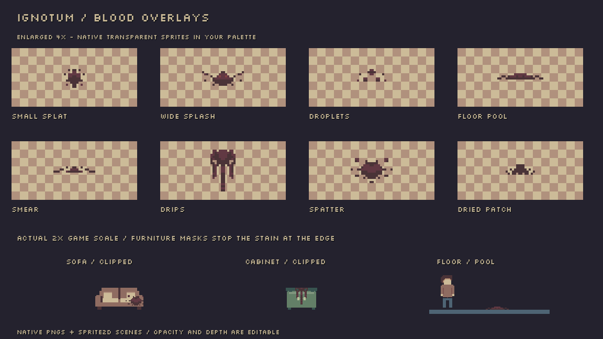

# Blood stains for floors and furniture

The kit contains eight transparent pixel-art overlays: small splat, wide splash, droplets, floor pool, smear, vertical drips, spatter and a dried patch. They use the existing palette and **2×** game pixel scale. No stains have been placed in your levels and no gameplay or enemy behaviour has changed.

## Place an overlay

1. Open your level and drag a named scene from **`scenes/objects/blood/`** into it. For example, use **blood_pool.tscn** for a thin floor pool or **blood_drips.tscn** for a cabinet front.
2. Position the stain visually over the floor/furniture. Its origin is the centre of its transparent canvas.
3. Adjust **Self Modulate → Alpha** in the Inspector to fade the stain and let more surface colour show through. Keep Alpha at 1 for the original solid pixel colours.
4. Use **Flip H**, **Flip V** or rotation to arrange it. Whole-pixel positions and 90-degree rotations preserve the pixel grid. Start with the supplied 2× scale to match the furniture and character.

Each scene is an ordinary **Sprite2D**. You can also drag a PNG from `art/pixel/blood/` into Godot, set its scale to **(2, 2)** and use nearest filtering. The common **blood_overlay.tscn** is a template; the eight named scenes already select their respective textures. There is no script, collision or interaction attached.

## Put blood on furniture

For a small stain fully inside a surface, add the overlay as a child of the furniture root and place it after **Artwork** in the Scene tree. It then follows the furniture when moved. The overlay's default **Z Index is 0 relative to its parent**, so it follows that furniture's depth and draws over earlier siblings at the same depth.

If the stain extends past the edge, use the furniture artwork as a mask:

1. On a placed furniture scene, enable **Editable Children** if needed and select its actual **Artwork** Sprite2D.
2. Search the Inspector for **Clip Children**, then choose **Clip + Draw**. This keeps the furniture visible while clipping its children to its texture's alpha shape.
3. Make the blood overlay a **child of Artwork**, rather than a sibling. Set its local **Scale to (1, 1)** because the supplied furniture Artwork is already scaled 2×. This prevents accidentally displaying the stain at 4×.
4. Position the stain using Artwork's local coordinates. Keep the overlay's relative **Z Index at 0** so it stays in the same masked drawing group.

Select the Sprite2D that actually draws the surface. A furniture Node2D root has no texture alpha to mask with. **Clip Only** hides the mask's own artwork; use **Clip + Draw** for this case. The blood sprite still stays independently editable, and clipping follows the current furniture texture when you change its colour variant.

If a piece of furniture has multiple separate artwork sprites, parent the stain to the particular sprite it should stain. Clipping follows transparency, so holes in that sprite remain holes. It does not distinguish painted sections such as wood versus upholstery within one opaque texture; position or edit the overlay to target that part.

## Depth and lighting

Use **Ordering → Z Index** to place stains at the same depth as their surface and below the player when the player should walk in front. A floor overlay placed after the player at the same Z may draw over the player; move it under your scenery/floor branch or choose a lower Z. For masked furniture, keep the stain's own Z at 0 and adjust the furniture's depth as a whole.

The sprites use normal Godot 2D lighting, like the furniture. Room darkness and lights affect them. They do not emit light or change the flashlight. Colour, opacity, position and depth adjustments belong to the individual overlay instance and do not require editing gameplay code.

## Edit the textures

Native PNGs are in **`art/pixel/blood/`**. Open them in Pixilart, keep the transparent background and existing palette, then export over the relevant PNG. The native canvases are listed in that folder's README. They are deliberately small and simple; the source pixels are displayed at 2× in the game.

The preview is a reference image under `docs/previews/`; its checkerboard/furniture are not baked into the game assets. The kit adds no automatic combat blood effects, save-state flags or authored story placements. All eight scenes are normal editor-visible scenery that you arrange yourself.

## Verification

The PNGs were checked for native dimensions, hard transparency and palette use. All named scenes share the correct template and textures. A graphical Godot 4.7.2 compatibility-renderer check verified **Clip + Draw** on actual furniture, with visible stain pixels inside the mask and none outside it.
