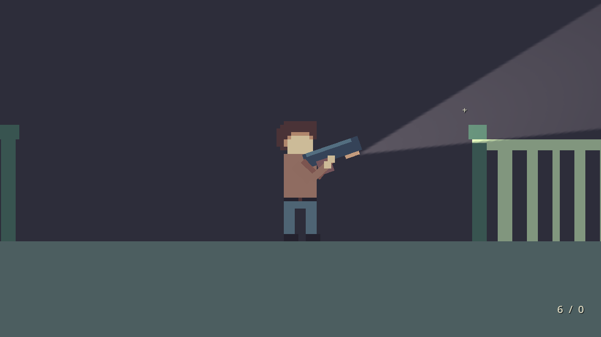
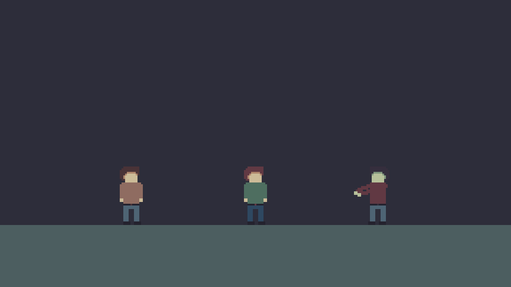

# Character animation and gun combat

For the completed editable player project based on your drawings, open [player_animation/player_motion.pixil](../../art/pixlart/player_animation/player_motion.pixil). The [animation pack](../downloads/Ignotum-completed-player-animations.zip) includes individual Pixilart timeline projects and PNG strips. The [blank animation templates](../../art/templates/characters/README.md) remain available for new drawings.

Open `scenes/levels/combat_sandbox.tscn` with **F6** in Godot **4.7.2 Standard**. Player and enemy use matching simple pixel art, distinct movement/reaction poses and editor-editable **Body → Sprite Frames** resources. F5 starts your main menu and town.

## Edit the supplied animation atlases

`art/pixel/player_motion.png` is **192×560 native pixels**, arranged **6 columns × 14 rows**, with **32×40 pixels per frame**. It matches the completed Pixilart master. The enemy remains **192×240**, **6×6**, with the same cell size. These are single native PNGs. Body uses **Position (0,32)**, **Offset (0,-20)** and **Scale (2,2)**; one native pixel is two world pixels.

| Player row | Animation |
| --- | --- |
| 1 | Idle |
| 2 | Walk |
| 3 | Sprint |
| 4 | Crouch idle |
| 5 | Crouch walk |
| 6 | Jump |
| 7 | Fall |
| 8 | Dodge |
| 9 | Aim idle |
| 10 | Aim walk |
| 11 | Crouch aim idle |
| 12 | Crouch aim walk |
| 13 | Aim jump |
| 14 | Aim fall |

All player rows have six frames. The initial idle/walk/run drawings and jump/fall entry poses come from your uploaded file, preserved separately in [player_animation/animations-human-made.pixil](../../art/pixlart/player_animation/animations-human-made.pixil). Grounded feet were moved down one native pixel to the frame boundary; the deepest idle bob uses a neighboring authored pose, and the repeated walk/run loop-ending frame has a shorter duration. New poses reuse your hair/face shape, proportions and simple clothing colors. See the [animated preview](../previews/player-animation-review.gif).

Enemy rows are unchanged: walk; sleep/wake; attack; hit; death; idle. The sample NPC atlas region now points to player row 1.

The player has brown **hair**, no hat, and a flat face without a protruding nose. The enemy matches its proportions with green skin and a burgundy shirt. Crouch and death are drawn poses; all temporary pose-compression options are disabled in the supplied scenes.

1. Open `scenes/actors/player.tscn` or `enemy.tscn`, select **Body**, and click **Sprite Frames**.
2. Select an animation by name. Replace its frames with individual PNGs or **Add frames from a sprite sheet** (6 horizontal × 14 vertical for the player, 6 × 6 for the enemy).
3. Keep the animation names. Set FPS and Loop, then save the shared `.tres` resource. To vary one enemy, use **Make Unique → Save As** first.
4. Keep native replacement frames 32×40 if using the supplied Body transform. For already-enlarged 64×80 frames, use Body Scale (1,1) and Offset (0,-40) instead. Keep feet at the bottom.

## Player states

`idle`, `walk`, `sprint`, `crouch_idle`, `crouch_walk`, `jump`, `fall`, `dodge` are selected by gameplay. Walk, run and crouch use distinct six-frame drawings. Jump, fall and the short dodge each have six-frame sequences. Air clips play once and hold; the dodge clip fits the existing action duration.

Aiming uses `aim_idle`, `aim_walk`, `crouch_aim_idle`, `crouch_aim_walk`, `aim_jump`, `aim_fall` when those clips exist. These bodies omit dangling arms so the aim rig can supply them. Missing optional aim clips fall back to their normal state; other missing states fall back to idle. Keep idle present.

The walk/crouch/run playback rate follows actual movement speed, so tuning speed does not leave a full-speed gait at a slow walk. Armed backwards movement reverses the walking cycle. The dodge clip fits **Dodge Seconds** without changing physics timing. Idle and other nonmoving states use their resource FPS.

## Hands holding the handgun

Hold right mouse to draw and aim the equipped weapon. Body facing follows aim even while moving in the other direction. Release it to holster the weapon and aiming arms; the flashlight returns to walking direction. Dodge temporarily hides the weapon/arms.

`Player/WeaponArms` instances `scenes/actors/weapon_arms.tscn`. Two simple editor-visible sleeve segments and a hand on each arm follow the gun's grip points. Both hands stay attached as the gun rotates, flips left, recoils and lowers for crouch. No additional inventory item is involved.

Select **WeaponArms** to tune **Near/Far Shoulder**, **Crouch Shoulder Offset**, **Near/Far Grip** (coordinates on the Gun sprite), **Upper Arm Length** and **Forearm Length**. Under Near/Far, select the Polygon2D sleeves and hands to change colors/shapes. Keep them simple to match your pixel art. The far sleeve is a darker palette shade. When substituting a differently shaped gun, move the grip points and `Aim/Gun/Muzzle` to its handle and barrel. The current rig targets one equipped weapon; future weapons with different grip geometry can be given additional resource settings later.

The existing gun and flashlight node paths remain `Aim/Gun`, `Aim/Gun/Flashlight` and `Aim/Gun/Muzzle`, preserving firing and Godot lighting. The Gun node remains active when its texture is hidden so its light children still work. The arm rig only changes presentation, not ammunition or damage.

## Keep the flashlight and arms aligned with new frames

The flashlight **points horizontally in facing direction unless right mouse is held**. Holding right mouse alone enables cursor aim, including when the pistol is unequipped. Animation changes its attachment position, not this direction rule. Its toggle and saved state remain unchanged.

During ordinary movement the beam starts at the drawn hand, following walk/run/crouch/jump/dodge poses. During armed aim it starts beside the pistol barrel and follows recoil. The gun, shoulders and aiming arms follow the animated chest. Per-frame attachment tracks have been replaced for the new artwork. Pelvis centers keep the visible body over its physical collider without changing movement or collision.

**Player → WeaponArms → Attachment Profile** references `data/animations/player_attachments.tres`. Open that resource and expand **Tracks**. Each track identifies an animation name and holds native image coordinates measured from the **top-left of a 32×40 frame**:

- **Body Centers**: horizontal pelvis center for each frame. This aligns the drawing over the collider; feet retain the authored vertical baseline.
- **Aim Origins**: chest points for each frame. These position the aim pivot and shoulder rig together.
- **Flashlight Hands**: hand points for holstered/unarmed frames. Armed torso clips omit these because the light follows the gun barrel instead.

The profile's **Reference Aim Position** is the original player-local baseline (0,-9); keep it unless intentionally recalibrating the rig. Entry 0 belongs to frame 0 in that animation's SpriteFrames list, regardless of where its texture sits in the atlas. The profile updates immediately as animation frames change and mirrors the coordinates automatically when facing left. Do not create separate left-facing tracks. If an animation has more frames than its point list, it safely holds the last entry; add matching entries when authoring the new poses. Missing tracks use the original fixed attachment fallback.

To tune a future redraw, change these point lists while keeping the animation names. **Body Position (0,32)** remains the editor base; runtime alignment adjusts its X per frame. Keep character artwork and attachment data together when sharing changes. No PNG editing or automatic color-based detection happens during gameplay.

On WeaponArms, **Handheld Flashlight Offset** adds a small world-pixel offset from the hand, default (2,0), mirrored by facing. **Barrel Flashlight Offset** is gun-local, default (14,4), mirrored vertically with the drawn gun. Those fields control the light's position during play; manually moving the PointLight2D position alone will be superseded. Its Energy, Color, Texture, Texture Scale and forward beam texture Offset are still ordinary Godot lighting settings.

## Movement tuning

Your uploaded player scene retains **Move Speed 125**, **Jump Velocity -200**, camera offset **(0,-110)**, zoom **(1.4,1.4)** and your camera limit settings. These can be overridden per scene as before. Other root settings include acceleration, gravity, jump buffering and coyote time.

| Setting | Default | Meaning |
| --- | --- | --- |
| Sprint Multiplier | 1.55 | Normal speed multiplier |
| Crouch Speed Multiplier | 0.45 | Normal speed multiplier |
| Crouch Height | 36 | Physical capsule height; feet stay planted |
| Dodge Speed / Seconds | 260 / 0.18 | Short grounded motion, about 47 world pixels |
| Dodge Invulnerability Seconds | 0.12 | Separate, shorter protected part of the dodge |
| Dodge Cooldown Seconds | 0.65 | Delay before the next dodge |

Crouching blocks jumping/dodging. Releasing crouch under a low ceiling keeps the smaller capsule until standing is safe. The drawn crouch silhouette can extend a few pixels outside the capsule, so check any tightly fitted ceilings with your final artwork. Aiming overrides sprint. Movement respects physical barriers. No stamina system is added.

## Enemy animation timing

Enemy clips: `idle`, `walk`, `sleep` loop; `wake`, `attack`, `hit`, `death` do not. Sleep/wake and attack/hit/death have real separate frames. **Wake Seconds**, **Hit Reaction Seconds**, and **Death Seconds** fit their respective clips to gameplay durations. Corpse Linger Seconds holds the final death frame; Leave Corpse keeps it until leaving the scene.

The default attack commits within 40 world pixels and uses a 40×44 hitbox matched to the short drawn strike. Attack visuals follow the actual **wind-up, active hit, recovery** phases. **Attack Windup Frames** defaults to 2, **Attack Contact Frames** to 2; the remaining two frames play during recovery. Change these counts if you insert a different number of frames. Changing phase durations stretches only that phase, keeping the arm strike synchronized to contact. Missing attack art still falls back safely without changing the damage rules.

Defeat immediately disables combat and records its world flag, which bicycle saves restore independently. Partial enemy HP, alertness, active attacks and corpse poses are transient. See [ENEMY_AI_GUIDE.md](ENEMY_AI_GUIDE.md) for hearing, sight, stealth bypasses and interruption rules.

## Controls in the editor

Project Settings → Input Map retains your bindings. Move left/right; Shift sprints; Ctrl/S/Down crouches; Space/W jumps; Alt dodges; right mouse aims; left mouse fires while aiming; R reloads; F toggles flashlight; E interacts; I/Tab toggles inventory; Esc closes panels or pauses. R rotates dragged inventory items. Control legends remain absent from the game for your authored tutorial.

## In-game previews

