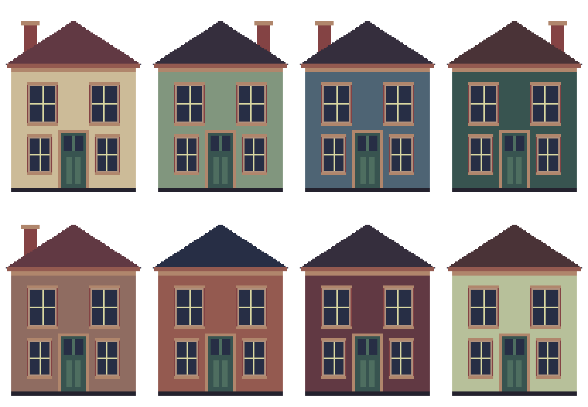

# House color variants

Eight separate, ready-to-place house assets based on your current house. The roof, eaves, windows, door panels, simple pixel detail, and proportions follow the existing sprite. Each front is exactly mirror-symmetric, with a centered door and matching windows. Five houses have one chimney on alternating sides; three have no chimney. Only the requested side chimneys break the roof silhouette’s symmetry.

| Variant | Chimney | Reusable scene in `scenes/objects/houses/` |
| --- | --- | --- |
| Cream | Left | `building_house_cream_left.tscn` |
| Sage | Right | `building_house_sage_right.tscn` |
| Slate blue | Left | `building_house_slate_blue_left.tscn` |
| Teal | Right | `building_house_teal_right.tscn` |
| Dusty rose | Left | `building_house_dusty_rose_left.tscn` |
| Terracotta | None | `building_house_terracotta_no_chimney.tscn` |
| Plum | None | `building_house_plum_no_chimney.tscn` |
| Pale olive | None | `building_house_pale_olive_no_chimney.tscn` |

## Place them in your level

Drag any of these `.tscn` files from FileSystem into your level's **Buildings** node, then move it in the 2D editor. They are ordinary Sprite2D scenes, visible and editable in the editor, with the same background Z Index (`-8`) as the original house. There is no runtime generation or placement script.

Each PNG is **96 × 128 native pixels**, matching your current source house. Each scene uses **Scale = (2, 2)** with nearest-neighbor filtering, giving the same **192 × 256 world-pixel canvas** as your existing house. For ground at Y = 620, place the centered house root at **Y = 492**. Its foundation reaches the same ground line.

The images live in `art/pixel/house_variants/house_<color>.png`. There is **one PNG per variant**, with no separate enlarged copy. Edit these files directly at native resolution. Keep the dimensions and the scene's 2× scale to preserve the current pixel size. If you assign one of these native PNGs directly to another Sprite2D, set that sprite's scale to `(2, 2)` as well.

The palette is copied from **Sparkle's palette** embedded in your current `art/pixlart/house.pixil`, rather than the older asset generator's palette. The included `art/pixel/ignotum.gpl` contains those exact 32 colors for use in your pixel editor. Every visible pixel in these variants belongs to that palette; alpha is either 0 or 255. Lighting in Godot can change their displayed appearance.

These scenes are background facades. For an enterable house, place the existing `scenes/objects/entrance.tscn` at the door and set its destination scene/spawn in the Inspector. You can hide that entrance's **Facade** child if you want to use only the door already painted on the house.

Your original house PNGs, Pixil file, existing building scenes, town layout, and gameplay code are preserved. The preview above is only an overview; the eight individual PNGs and eight scenes are the usable assets.
