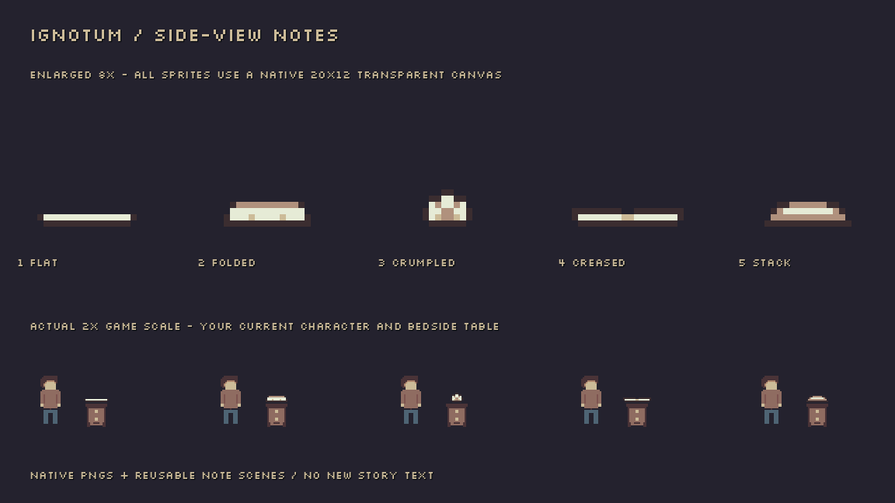

# Side-view note variants

Five small paper profiles are ready to place on your tables, shelves or floors. Each inherits the existing Note scene, so reading documents, nearby prompts and saved read progress work as before. No new story text or level placements have been added.

## Choose a scene

| Scene under `scenes/objects/notes/` | Appearance |
| --- | --- |
| `note_flat.tscn` | Almost-flat single sheet |
| `note_folded.tscn` | Folded letter |
| `note_crumpled.tscn` | Crumpled paper ball |
| `note_creased.tscn` | Low sheet with a small crease |
| `note_stack.tscn` | Small paper stack |

1. Drag the scene you want into your level.
2. Position its **root/origin** on the surface where the paper should rest. All five share the same bottom alignment. The Sprite2D is already positioned and scaled for that origin, so you can switch between the PNGs without changing the resting height.
3. Select the root **Note** and assign your **Document** resource in the Inspector. Use separate NoteDocument resources for different pieces of writing; editing a shared document changes every note using it.
4. Set **Persistent Id** to a unique name for that particular note, keeping it unchanged when moving the note later. Adjust **Interaction Radius** or **Prompt Offset** if needed.

The existing `scenes/objects/note.tscn` now uses the flat side-view sheet by default. Its root identity, document and interaction settings are retained. Existing placed notes keep their authored root positions; align a root with the tabletop if the old centered wall-note artwork had been placed above or below that surface. Your level files have not been repositioned automatically.

## Change the appearance of an existing note

Keep the existing note node and its Persistent Id so old saves can still identify it. Enable **Editable Children** on the scene instance if needed, select **Sprite2D**, then assign one of the PNGs from **`art/pixel/notes/`** to **Texture**. All five textures use the same canvas and surface alignment. This changes appearance without replacing the note interaction or document.

For reusable variants, use the five supplied scenes. Each shares the original reading script; there are no copied gameplay scripts to keep synchronized.

## Edit the artwork

Open the native PNGs in Pixilart. All are **20×12** transparent pixels and are displayed at **2×**, matching the existing furniture/character pixel scale. The first and fourth profiles are deliberately low and flat. The third is crumpled paper rather than the earlier triangular fold.

Keep the 20×12 canvas, transparent background and bottom alignment when exporting over a PNG. Use nearest-neighbor display and the project's palette; the supplied sprites use four existing paper/outline colors. The PNG files are the editable runtime assets, with normal Godot `.png.import` metadata alongside them. `docs/previews/side-view-notes.png` is a reference image, not an additional runtime asset.

The older `art/pixel/notice.png` is retained for your own wall-note/poster use. The default note scene now points to the new flat profile.
