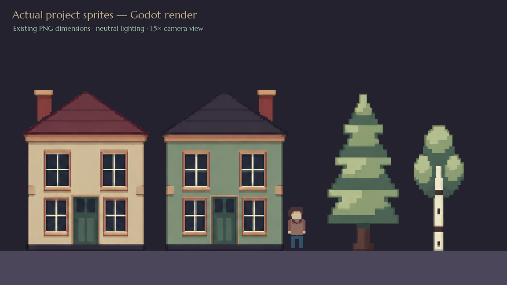

# Approved world artwork: actual game render

This image is captured from Godot 4.7.2 using the project's actual house and tree scenes and PNG files, with neutral lighting and a 1.5× camera view. It is not an image-generation mockup. Normal level lights tint and brighten the same textures.

The earlier exports incorrectly repainted the source artwork through old internal colour regions and reduced shade ramps. That removed the approved detail. The corrected exports use the approved artwork directly, retaining its colours, shading and drawing outlines at the existing PNG canvas sizes and ground anchors. RGB shading is not reflected. Left/right/no-chimney house variants retain their intended configuration; seasonal tree variants preserve the same shading while changing leaf colours.

The original approved artwork used for these exports is retained here:

- [House variants](sources/houses.png)
- [Other buildings](sources/buildings.png)
- [Trees](sources/trees.png)

These source atlases are larger than the game sprites. For future reviews, compare the actual Godot render or the game PNGs at their native size; a large source illustration is not a substitute for that check. Character textures, designer item redraws, game scripts, scene layouts, collisions and settings are unchanged by this export correction.
