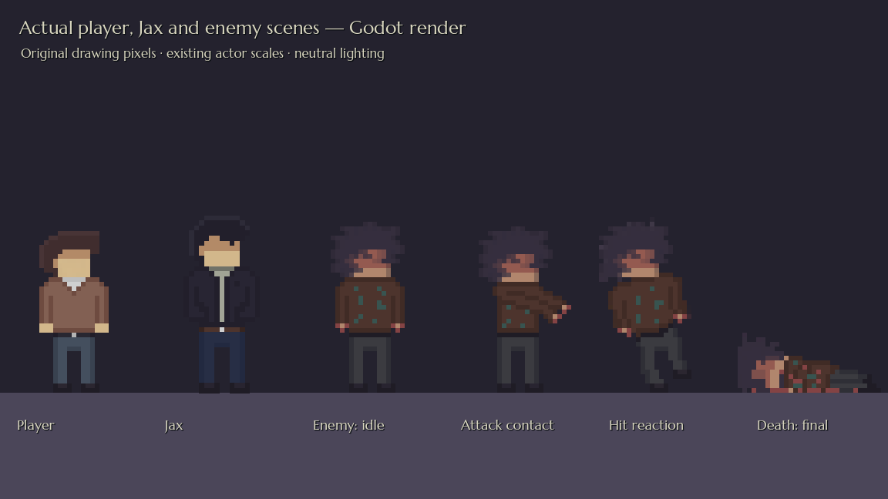
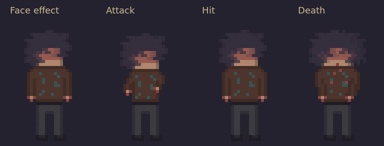
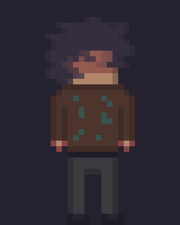
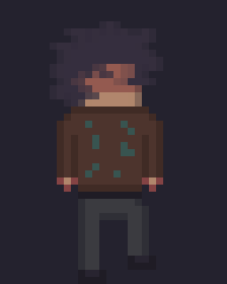
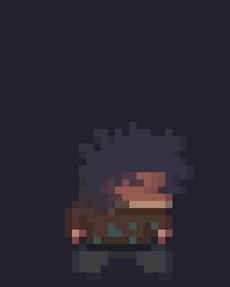
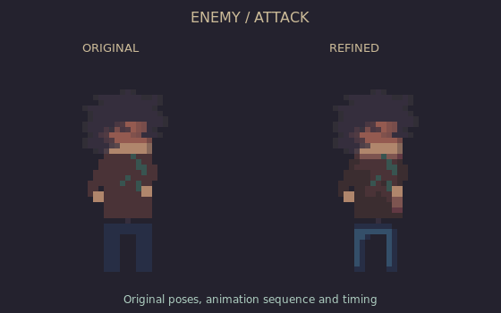
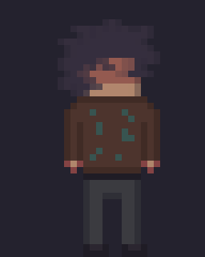
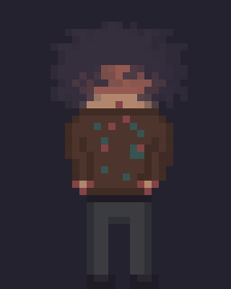

# Designer-redrawn enemy

The runtime PNG is copied **byte-for-byte from visible Layer 2** of `enemy_redesign.pixil`. All 42 drawn cells, their colours and partial transparency are preserved. Hidden template layers are retained in the editable document and excluded from the game PNG. The full **192×560** canvas stays intact; the lower seven blank rows are unused.

## Actual Godot render

The real player, Jax and enemy scenes are loaded under neutral lighting, using their existing actor scales. The enemy is shown in idle, attack contact, hit and final death poses.

## Motion previews

The comparison strip below is slowed for inspection. It uses the actual imported cells, with partial alpha composited onto a neutral background for GIF display only. The source/game PNG keeps its original alpha values.

The following state previews use the existing base animation/gameplay durations, rounded to GIF timing precision. Looping a preview is for review; gameplay still controls state transitions, attack intervals and corpse removal.

[View the seven populated rows enlarged 3×](enemy-sheet.png). Only that preview is cropped.

## Editable files

- `art/pixel/enemy_motion.png`: exact visible drawing-layer PNG.
- `art/pixlart/cast_animation/enemy_motion.pixil`: current editable master; draw on **Layer 2**. All original layers, visibility flags, palette and canvas are preserved. Only its malformed global thumbnail was replaced with the valid frame preview.
- `art/pixlart/cast_animation/enemy_redesign.pixil`: original uploaded file, unchanged byte-for-byte.
- `art/templates/characters/enemy_authored_frames.png`: exact full drawing for preservation checks.

In the sheet picker use **6 horizontal × 14 vertical** with **32×40** cells. The populated rows are idle, walk, sleep, wake, attack, hit and death. Empty lower rows are never animation frames.

Enemy SpriteFrames, actor scene and AI code are unchanged. Frame order, weighted durations, FPS, windup/contact/recovery split, wake/hit/death durations, hurt sound, collision and attack shapes, position/scale/offset, damage, awareness and save/story behaviour remain as configured. Player and Jax artwork is unchanged.

## Verification

Godot passes **197 checks** across character artwork/attachments, combat, stealth and story activation. These include exact imported pixels and partial effect alpha, all seven animation mappings, timed attack phases, sleeping/waking, hit reactions, gun damage, death/corpse handling, inactive-enemy physics and independent saved defeat/story flags. All 151 reusable/fixture scenes, 39 resources and 24 entrance links resolve; all 12 designer levels start and clean up. Native art checks pass.

The original upload and all master layers are verified against the source document; its drawing and both repaired/current preview PNGs decode correctly. Opening the file in the Pixilart application could not be tested here.
