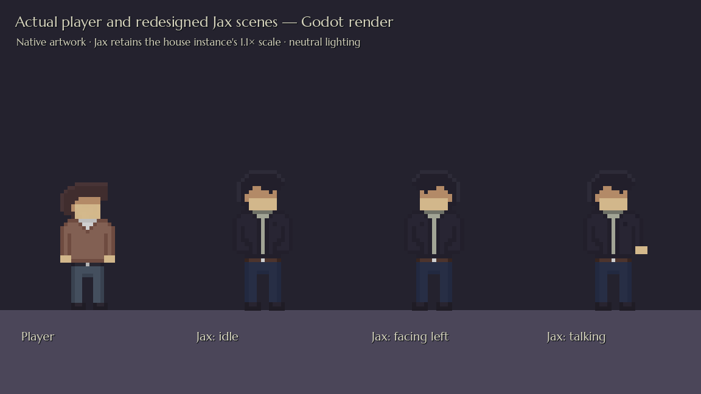
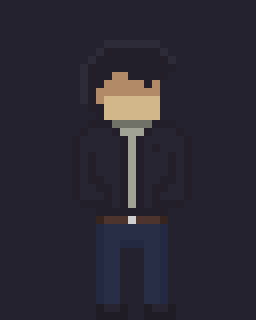

# Designer-redrawn Jax

Jax's new PNG is copied **byte-for-byte from the drawing on Layer 1** of `jax_redesign.pixil`. Colours, shading, native cells and transparent template space are unchanged. The empty Background layer is retained in the editable document.

## Actual Godot render

The real player and Jax scenes are loaded under neutral lighting. Jax uses the existing **1.1× house-instance scale**; his Body stays at 2× native scale. The idle, mirrored and talking poses use the imported drawing. Gameplay lighting still affects colours.

## Actual animations

These GIFs use the existing scene's frame order, individual durations and playback speeds.

[View the two populated rows enlarged 4×](jax-sheet.png). Only this preview is cropped; the game PNG and Pixilart master keep the full **192×560** canvas.

## Integration and editable files

- `art/pixel/npc_jax_,motion.png`: exact full drawing-layer PNG, retaining the existing texture path and UID.
- `art/pixlart/cast_animation/npc_jax_motion.pixil`: current editable master. **Layer 1** is selected. Its malformed global thumbnail was replaced with the valid frame preview; both drawing layers, palette and native dimensions are preserved.
- `art/pixlart/cast_animation/jax_redesign.pixil`: original uploaded file, unchanged byte-for-byte.
- `art/templates/characters/jax_authored_frames.png`: exact full drawing for regression checks.

The first row supplies idle poses and the second talking poses. Explicit **32×40 AtlasTexture regions** exclude all empty lower rows, so the larger template does not enlarge or offset Jax. In the sprite-sheet picker use **6 horizontal × 14 vertical**, choosing only the populated top rows.

The existing weighted idle/talking sequences, speeds and durations are retained. The only scene edits redirect the two idle AtlasTexture regions to row 1. Talking regions remain on row 2. Body transform, the house's placed position/scale, scene UID, node paths, dialogue resources, speaker aliases, repeat conversation and completion flag are unchanged. The player, generic NPC and enemy artwork are untouched by this import.

## Verification

Godot passes **94 dialogue/story checks**, including the exact imported pixels, nonempty 32×40 frames, feet anchoring, unchanged animation timing, facing both interaction directions, pausing/animation, both real Jax dialogue branches, voice playback, completion flags, enemy activation and independent saved progress. A pre-existing story test required unrelated legacy flag-action lists to be empty; that check now verifies the whole-enemy activation target while retaining its runtime AI/physics checks. No enemy or level settings were changed.

All 151 reusable/fixture scenes, 39 resources and 24 entrance links resolve; all 12 designer levels start and clean up. Native art validation passes. The original upload and both visible layers are verified against the editable document. Opening the file in the Pixilart application could not be tested here.
