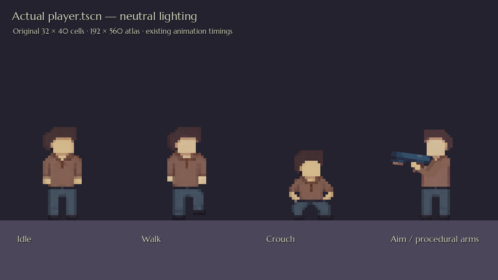
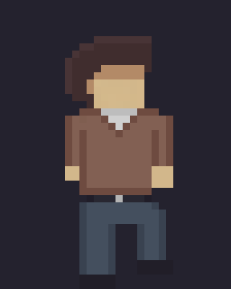
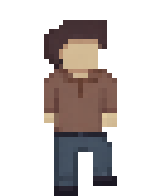
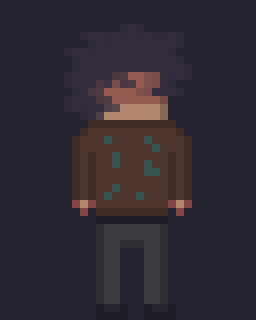
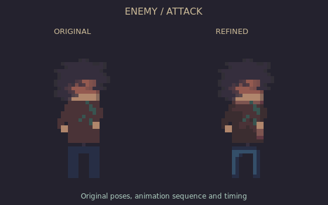

# Current player export and cast previews

This player image is a **Godot render of the actual `player.tscn`**, using its game PNG, attachment calibration and aiming arms under neutral lighting. The walk GIF is assembled from the actual exported animation frames in their existing playback order. These are the assets included in this commit.

The complete player design now comes from the approved artwork: head/hair, skin, polo collar and placket, restrained shirt shading, blue-grey trousers and dark shoes. It replaces the earlier version that kept the old head and hands and flattened the clothing. The atlas stays **192×560**, with **32×40** cells; the larger reference is sampled at that native resolution. Grounded feet keep their baseline. SpriteFrames order and durations, movement settings, collision and level layouts remain unchanged. The flashlight/shoulder points and procedural arm colours have been recalibrated for the new drawing.

The [approved walking source](player-sources/approved-walk.png) and other pose sources are archived in `player-sources/`. Exporting uses nearest-neighbor sampling of the full artwork; it does not restore old sprite masks or reduce the result to the old palette. Armed variants use their armless torso drawings and the matching normal movement legs. Intermediate source shades remain intact. In gameplay the level's lights and CanvasModulate still affect the resulting colours; the render above isolates the artwork.

Edit `art/pixel/player_motion.png` or the visible **REFINED CAST - DRAW HERE** layer in `art/pixlart/player_animation/player_motion.pixil`. The master retains the original hidden author layers; its active layer and previews contain the exact current PNG. The older animation download pack and earlier preview pages document earlier art. Pixilart JSON and embedded PNGs are validated; reopening the file in the Pixilart application could not be tested here.

Jax and enemy artwork is unchanged by this player correction. These existing comparison GIFs show previous shading on the left and their current shading on the right:

The designer's November 1 combat-kit, shotgun and shotgun-shell PNGs remain byte-for-byte intact. See [the art guide](../../guides/ART_STYLE_GUIDE.md) for asset locations.

## Verification

Godot 4.7.2: 206 checks pass across character art/attachments, aiming, pushables, entrance audio, the existing audio system and room doors. All 151 reusable/fixture scenes, 39 data resources and 24 entrance links resolve, and all 12 designer levels initialize and clean up. Native art validation passes. Source/movement SpriteFrames, level files, project settings and the designer’s three item PNGs are preserved.
