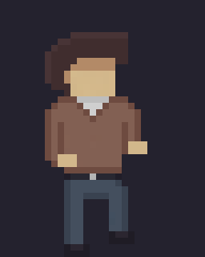
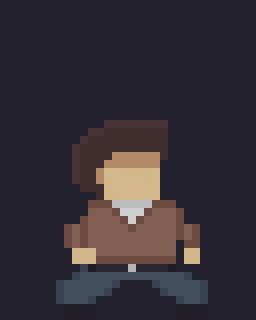

# Player animations from the designer's native reference

The player's design comes from the top-left frame in the uploaded `player.pixil`. That exact 32×40 frame is retained unchanged in the game's top-left cell. Its unscaled head is identical across all 84 cells. The collar, pale grey neckline, brown sleeves, grey belt buckle, simple trouser edges and existing animation poses carry through the sheet using only colours already present in the reference.

The images and GIFs below are made from **the actual production PNG**. The Godot capture loads `player.tscn`, including its aiming arms, under neutral lighting. Level lighting still affects its appearance in gameplay.

[Open the whole exported sheet at 4× native scale](player-sheet.png).

[Original designer frame, native 32×40](designer-reference.png) · [The same top-left cell enlarged from the production PNG](player-native.png)

## Editable files

- `art/pixlart/player_animation/player_motion.pixil`: the completed current sheet. Its visible **REFINED CAST - DRAW HERE** layer and both previews exactly match the game's `art/pixel/player_motion.png`. Earlier author/guide layers stay hidden underneath.
- `art/pixlart/player_animation/player_style_reference.pixil`: the uploaded source document, preserved byte-for-byte.
- `art/templates/characters/player_style_reference.png`: the exact native reference cell, also the detail standard for future NPC artwork.

The atlas remains **192×560**, arranged **6×14 cells of 32×40**. Grounded and lifted foot baselines, animation playback order/durations, movement, collision and level layouts remain unchanged. Flashlight and shoulder attachment points and procedural sleeve colours match the current drawing. No high-resolution artwork is resampled into this version, and no new gradients or moving crease patterns are added.

The Pixilart JSON and embedded PNGs are validated; opening the document in the Pixilart application could not be tested here. Older download packs and preview pages document earlier art. Jax/enemy sheets and their authored face effects are unchanged in this player-sheet update.

## Verification

The character/attachment and aiming suites pass **75 checks** in Godot 4.7.2, including exact reference preservation, identical heads in all 84 cells, flashlight alignment for each movement frame facing both ways and standing/crouched weapon grips. Native pixel checks confirm hard transparency, no added colours and unchanged foot baselines. The active Pixilart layer/previews match the PNG exactly. The designer's combat-kit, shotgun and shell PNGs remain unchanged.
