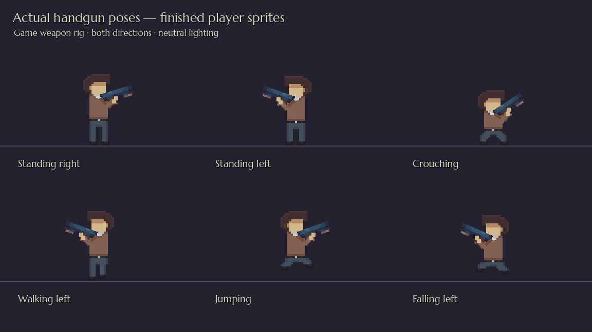
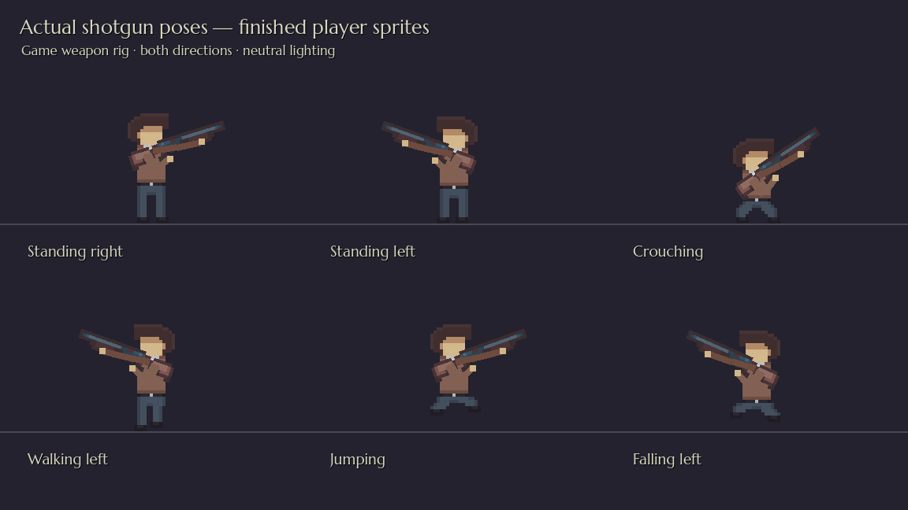
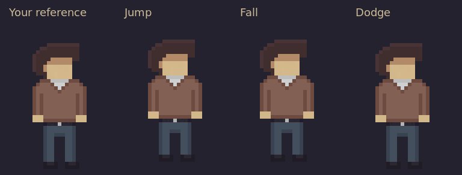

# Finished player sheet: direct import

All **84 cells** come directly from the designer's latest **`player_redesign_1.pixil`**. The game's PNG is the exact PNG embedded in its drawing layer. No sprite pixels, colours, poses or dimensions were changed.

## Actual game renders

These images load the real player scene and weapon rig in Godot under neutral lighting. They show the imported drawings and calibrated attachment points. Level lighting still affects colours in gameplay.

## Exported animations

This inspection GIF uses the actual game PNG. Airborne poses are displayed at a fixed origin, and the jump/fall/dodge review is slowed; gameplay supplies the player's vertical movement and action timing.

[Complete imported sheet enlarged 4×](player-sheet.png).

## Files and integration

- `art/pixel/player_motion.png`: the uploaded drawing-layer PNG, byte-for-byte.
- `art/pixlart/player_animation/player_motion.pixil`: current editable master with the designer's single **Background** layer and palette. Its malformed global thumbnail was replaced with the valid embedded frame preview; the drawing layer and other metadata stay unchanged.
- `art/pixlart/player_animation/player_redesign_1.pixil`: original upload, byte-for-byte.
- `art/templates/characters/player_authored_frames.png`: the full exact sheet used for preservation checks. Older reference documents and download packs are historical.

The atlas stays **192×560**, arranged in **6×14 cells of 32×40**. All animation states now use their six cells in sheet order: the old shuffled crouch idle and reused sixth walk-column reference were corrected. FPS and per-frame durations are unchanged. Body centres follow the drawn belt buckle; shoulder/flashlight coordinates follow each frame's shirt and hand positions. The physics body, collision shape, movement tuning and camera are unchanged.

The handgun and shotgun retain their own grip points, muzzle offsets, recoil and reload rules. Native tests check both hands, shoulders, muzzle flashes and barrel lights across every armed frame in both directions and at four aiming elevations. Holstered lights follow the actual drawn hand in every movement frame. No dangling drawn hands are added to the supplied armed rows.

The editable document's JSON, drawing PNG and both preview PNGs are validated. Opening it inside Pixilart could not be tested here. The enemy artwork and authored effects are unchanged. Jax was subsequently imported from the designer's new sheet; see [Jax's separate preview page](JAX.md).

## Verification

Godot 4.7.2 passes **91 character/aiming checks**, including full 84-cell preservation, sheet order, palette, head consistency, all frame attachments, both weapons firing/reloading, holstering and unarmed flashlight controls. All 151 reusable/fixture scenes, 39 data resources and 24 entrance links resolve; all 12 designer levels start and clean up. Native art validation passes. The designer's kit, shotgun and shell PNGs remain unchanged.
